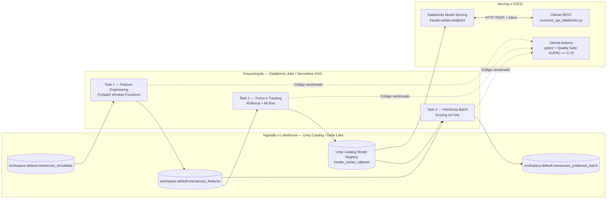

# 💳 Detecção de Fraudes em Cartões de Crédito: Do Cost-Sensitive Learning ao MLOps no Lakehouse


Este projeto desenvolve uma solução **end-to-end de detecção de fraudes em cartões de crédito**, conectando Ciência de Dados, engenharia de dados e MLOps. A jornada começa com a análise estatística de uma base extremamente desbalanceada, evolui para a criação de variáveis comportamentais e otimização financeira das decisões e termina com um pipeline distribuído no **Databricks**, governança de modelos com **MLflow e Unity Catalog**, disponibilização via API REST, inferência em lote, orquestração e testes automatizados com GitHub Actions.

O objetivo não é apenas encontrar um modelo com boa métrica preditiva. É demonstrar como transformar dados transacionais em sinais de risco e como levar esses sinais a um fluxo reprodutível, versionado, testável e acessível por diferentes modalidades de inferência.

> **Duas perguntas orientam o projeto:**
>
> 1. **Ciência de Dados e negócio:** como identificar eventos raros — menos de 0,2% das transações — sem confundir alta acurácia com boa detecção e sem ignorar o custo de bloquear clientes legítimos?
> 2. **Engenharia de ML e MLOps:** como transformar a experimentação em um pipeline distribuído, com prevenção de *data leakage*, rastreabilidade, serving em tempo real, inferência em lote e validação contínua?

---

## Sumário

- [O problema de negócio](#o-problema-de-negócio)
- [Dados e desenho experimental](#dados-e-desenho-experimental)
- [Arquitetura end-to-end](#arquitetura-end-to-end)
- [Stack tecnológica](#stack-tecnológica)
- [Fase 1 — Fundamentos estatísticos e dataset do Kaggle](#fase-1-fundamentos-estatísticos-e-dataset-do-kaggle)
- [Fase 2 — Engenharia comportamental e Cost-Sensitive Learning](#fase-2-engenharia-comportamental-e-cost-sensitive-learning)
- [Fase 3 — Feature Engineering distribuído com PySpark](#fase-3-feature-engineering-distribuído-com-pyspark)
- [Fase 4 — MLflow, Unity Catalog e Model Serving](#fase-4-mlflow-unity-catalog-e-model-serving)
- [Fase 5 — Batch, DAG e CI/CD](#fase-5-batch-dag-e-cicd)
- [Estrutura do repositório](#estrutura-do-repositório)
- [Execução local](#execução-local)
- [Limitações e próximos passos](#limitações-e-próximos-passos)

---

## O problema de negócio

Detectar fraudes é encontrar uma agulha em um palheiro — e cada tipo de erro tem uma consequência diferente.

| Tipo de erro | O que acontece | Impacto para a instituição |
| :--- | :--- | :--- |
| **Falso negativo** | Uma transação fraudulenta é aprovada. | Perda financeira, *chargeback*, custos de contestação e investigação. |
| **Falso positivo** | Uma transação legítima é bloqueada. | Atrito na experiência do cliente, custo de atendimento, perda de receita e possível *churn*. |

Em uma base na qual apenas cerca de 0,17% das transações são fraudulentas, um classificador trivial que marque **todas** as compras como legítimas alcançará aproximadamente **99,83% de acurácia**. Apesar desse número aparentemente excelente, ele não detectará fraude alguma.

Por isso, a avaliação precisa ir além da acurácia. O projeto trabalha com duas perspectivas complementares:

- **Qualidade preditiva:** métricas como *Precision*, *Recall* e **AUPRC** ajudam a avaliar a capacidade de identificar a classe minoritária.
- **Consequência financeira:** a simulação de *thresholds* compara o valor associado às fraudes bloqueadas com a quantidade de transações legítimas bloqueadas por engano.

A ideia central é que uma probabilidade de fraude não é, sozinha, uma decisão de negócio. O limiar usado para bloquear uma compra deve considerar o custo relativo dos erros e o nível de atrito que a operação está disposta a aceitar.

---

## Dados e desenho experimental

O projeto utiliza **duas bases com propósitos diferentes**. Elas não são simplesmente uma única base dividida em etapas: a primeira permite estudar o desbalanceamento em dados anonimizados; a segunda permite trabalhar com informações transacionais e construir variáveis comportamentais.

### Base 1 — Dataset de cartões de crédito do Kaggle

A primeira etapa utiliza o conhecido dataset de fraudes em cartões de crédito disponibilizado no Kaggle, com transações de usuários europeus realizadas em setembro de 2013.

| Característica | Valor |
| :--- | ---: |
| Total de transações | **284.807** |
| Transações fraudulentas | **492** |
| Participação de fraudes | **0,172%** |
| Variáveis anonimizadas | `V1` a `V28` |
| Variáveis com escala original | `Time` e `Amount` |

#### O que são `V1` a `V28`? Entendendo o PCA

Por questões de confidencialidade, as variáveis originais da transação não estão disponíveis em sua forma interpretável. Em seu lugar, o conjunto apresenta 28 componentes numéricas (`V1` a `V28`) obtidas por **Análise de Componentes Principais (PCA)**.

Uma forma intuitiva de pensar no PCA é imaginar que um conjunto complexo de características é reorganizado em novos eixos, que resumem a variação dos dados. Em vez de trabalhar diretamente com as variáveis originais, o modelo recebe combinações lineares delas.

No conjunto transformado:

1. As componentes são ordenadas pela variância explicada: `V1` representa a maior parcela de variância e `V28`, a menor.
2. As componentes são ortogonais e, no espaço transformado, não apresentam correlação linear entre si. Isso reduz a multicolinearidade linear entre essas variáveis.
3. A interpretação semântica das variáveis originais não pode ser recuperada apenas olhando para `V1`, `V2` etc.; elas são representações matemáticas, não descrições como tipo de loja ou dispositivo.

As variáveis `Time` e `Amount` não passaram pela mesma transformação: `Time` representa os segundos decorridos desde a primeira transação do conjunto, enquanto `Amount` representa o valor da compra.

### Base 2 — Simulador de transações para engenharia comportamental

Na segunda etapa, o projeto deixa de depender exclusivamente das componentes anonimizadas. Foi utilizada a metodologia de um simulador de transações associado ao *Machine Learning Group* da **Université Libre de Bruxelles (ULB)** para trabalhar com registros transacionais que incluem informações como horário, valor, coordenadas/localização, identificadores de clientes e terminais e rótulo de fraude.

Essa base permite construir variáveis que representam padrões de comportamento, como frequência de compras em janelas recentes, volume financeiro transacionado e histórico de fraude associado a um terminal. As coordenadas fazem parte da descrição dos dados brutos, mas não aparecem entre as oito features finais listadas para o treinamento nesta versão do pipeline.

> **Por que usar duas bases?** A primeira etapa demonstra o tratamento estatístico de um problema extremamente desbalanceado. A segunda aproxima o experimento de uma situação de negócio, na qual é possível transformar registros brutos em variáveis comportamentais. Resultados obtidos em uma base não devem ser interpretados automaticamente como validação na outra.

---

## Arquitetura end-to-end

A arquitetura conecta a ingestão das transações ao processamento distribuído, treinamento, registro do modelo e dois caminhos de inferência: um síncrono, via API REST, e outro em lote, persistido em uma tabela Delta.



O desenho representa os principais componentes do fluxo. A execução automatizada das três tarefas é encadeada no Databricks Jobs; o GitHub Actions, por sua vez, verifica o código versionado por meio de testes e de um *Quality Gate*.

---

## Stack tecnológica

| Camada | Tecnologia | Papel no projeto |
| :--- | :--- | :--- |
| **Prototipação e estatística** | Python, Pandas, NumPy, Scikit-Learn e Matplotlib | Exploração, preparação, escalonamento, métricas e simulação financeira de limiares. |
| **Modelagem preditiva** | XGBoost e Random Forest | Classificação de transações e comparação de modelos em dados tabulares desbalanceados. |
| **Engenharia distribuída** | PySpark e Delta Lake | Construção de variáveis temporais em escala e persistência transacional no Lakehouse. |
| **Rastreamento e governança** | MLflow e Unity Catalog | Registro de experimentos, parâmetros, métricas, artefatos e versões de modelos. |
| **Serving** | Databricks Model Serving e `requests` | Exposição do modelo por uma API REST e consumo externo via HTTP. |
| **Orquestração** | Databricks Jobs | Encadeamento das tarefas de engenharia, treino e inferência em um DAG. |
| **CI/CD e testes** | GitHub Actions e Pytest | Execução automatizada de testes e bloqueio de regressões por critérios mínimos. |

---

## Fase 1: Fundamentos estatísticos e dataset do Kaggle

**Objetivo:** estudar o desbalanceamento extremo e estabelecer uma linha de base preditiva utilizando variáveis anonimizadas, com atenção especial à preparação dos dados e à escolha das métricas.

### 1. Escalonamento e prevenção de Data Leakage

As componentes `V1` a `V28` já estão em uma representação transformada. `Time` e `Amount`, porém, mantêm suas escalas originais e podem apresentar distribuições muito diferentes, com valores extremos.

**Por que `RobustScaler` em vez de `StandardScaler`?**

- O `StandardScaler` centraliza os dados pela média e divide pelo desvio-padrão. Essas estatísticas podem ser bastante influenciadas por valores extremos.
- O `RobustScaler` utiliza a mediana e o **intervalo interquartil** (*Interquartile Range* — `IQR = Q3 - Q1`). Dessa forma, o escalonamento de `Time` e `Amount` fica menos sensível aos *outliers*.
- O ajuste (`fit`) do escalonador é feito somente no conjunto de treino. Depois, a transformação (`transform`) é aplicada ao treino e ao teste. Isso evita que estatísticas calculadas com os dados de teste contaminem o treinamento.

Esse cuidado é uma forma de prevenir **data leakage**: informações que deveriam estar indisponíveis durante o treinamento não podem influenciar a preparação do modelo.

### 2. Estratégias para lidar com o desbalanceamento

O modelo não pode simplesmente aprender a classificar quase tudo como legítimo. Uma das estratégias adotadas foi a ponderação de classes (*Class Weights*).

- No XGBoost, foi utilizado o parâmetro `scale_pos_weight`.
- No Random Forest, foi utilizado `class_weight='balanced'`.
- A ponderação aumenta a importância dos erros associados à classe minoritária durante o treinamento, considerando a proporção entre exemplos negativos e positivos.

Essa abordagem foi escolhida em vez de reduzir drasticamente a classe majoritária (*undersampling*) ou criar observações sintéticas com SMOTE. Não significa que essas técnicas sejam sempre inadequadas; a escolha busca preservar os registros legítimos disponíveis e evitar que a avaliação dependa de exemplos artificiais.

### 3. Por que AUPRC em vez de acurácia?

A **AUPRC** (*Area Under the Precision-Recall Curve*) resume o comportamento conjunto de *Precision* e *Recall* ao longo de diferentes limiares de classificação.

- **Precision:** entre as transações sinalizadas como fraude, qual proporção realmente era fraudulenta?
- **Recall:** entre todas as fraudes existentes, qual proporção foi identificada?
- **AUPRC:** resume o compromisso entre *Precision* e *Recall* em diferentes *thresholds*.

Em uma base com pouquíssimos positivos, a acurácia pode esconder um modelo que não identifica nenhuma fraude. A ROC-AUC continua sendo uma métrica útil em determinados contextos, mas a curva Precision-Recall oferece uma leitura mais direta do desempenho sobre a classe rara.

### Resultados reportados

| Modelo | AUPRC |
| :--- | ---: |
| Random Forest | **0.8656** |
| XGBoost | **0.8608** |

No `classification_report` da avaliação realizada, o desempenho reportado para a classe fraude foi:

- **Precision: 87%** — aproximadamente 87 de cada 100 transações sinalizadas eram fraudes reais.
- **Recall: 86%** — aproximadamente 86% das fraudes existentes foram identificadas.

Essas métricas devem ser interpretadas em conjunto: aumentar o *Recall* pode elevar a quantidade de falsos positivos, enquanto aumentar a *Precision* pode deixar fraudes passarem sem bloqueio.

---

## Fase 2: Engenharia comportamental e Cost-Sensitive Learning

**Objetivo:** sair das variáveis anonimizadas e construir uma representação comportamental das transações. Nesta etapa, o foco muda de apenas treinar um classificador para entender quais sinais de negócio podem indicar uma atividade suspeita e como transformar a probabilidade do modelo em uma decisão financeira.

### 1. Feature Engineering: do registro bruto ao comportamento

Identificadores como `CUSTOMER_ID` e `TERMINAL_ID` não são, por si só, boas descrições do comportamento. Um algoritmo pode memorizar padrões específicos dos IDs sem aprender características que generalizem para novos clientes ou terminais.

Por isso, os registros foram transformados em variáveis analíticas:

| Grupo de variáveis | Features | Interpretação |
| :--- | :--- | :--- |
| **Padrão temporal** | `TX_TIME_HOURS`, `TX_DAY_OF_WEEK` | Hora do dia e dia da semana em que a transação ocorreu. |
| **Velocidade — 1 hora** | `TX_COUNT_1H`, `TX_SUM_1H` | Quantidade de compras e valor total movimentado pelo cliente na janela recente de uma hora. |
| **Velocidade — 24 horas** | `TX_COUNT_24H`, `TX_SUM_24H` | Quantidade de compras e valor total movimentado pelo cliente na janela recente de 24 horas. |
| **Risco do terminal** | `RISCO_TERMINAL` | Taxa histórica de fraude associada ao terminal, calculada com informações anteriores à transação avaliada. |
| **Valor da transação** | `TX_AMOUNT` | Valor da compra analisada. |

As *Velocity Rules* procuram capturar comportamentos como várias compras em sequência ou uma concentração atípica de gastos em pouco tempo. A extração de hora do dia também permite investigar padrões como compras realizadas durante a madrugada. Já o `RISCO_TERMINAL` procura representar se determinado ponto de venda possui um histórico anterior de ocorrências fraudulentas.

### 2. Diagnóstico da importância de `TX_AMOUNT`

O XGBoost treinado sobre a matriz comportamental atingiu os seguintes resultados reportados:

- **AUPRC: 0.81**
- **Precision: 100%**
- **Importância normalizada de `TX_AMOUNT`: 1.0**

A análise de `feature_importances_` indicou que `TX_AMOUNT` concentrou toda a importância registrada pelo modelo nessa execução.

**O que esse resultado significa?** No cenário sintético utilizado, um dos padrões de fraude introduzidos pelo simulador está fortemente associado ao valor da transação — incluindo um comportamento semelhante ao esvaziamento abrupto de limite. O modelo encontrou nesse atributo um sinal suficiente para realizar as divisões que sustentaram suas predições.

Essa descoberta é interessante, mas precisa ser interpretada com cuidado:

- Importância normalizada igual a `1.0` significa que toda a importância atribuída pelo método utilizado ficou concentrada nessa variável; **não** significa que a feature tenha 100% de acurácia nem que explique universalmente o fenômeno de fraude.
- Uma variável dominar completamente o modelo pode revelar uma regra muito forte do simulador, mas também é um sinal para investigar possíveis atalhos, regras artificiais ou vazamento de informação.
- Em dados financeiros reais, o valor da compra deve ser analisado junto com o histórico do cliente, o contexto temporal, o terminal e outras informações disponíveis no momento da autorização.

Esse diagnóstico motivou a preocupação com a construção de variáveis temporais estritamente históricas, aprofundada na Fase 3.

### 3. Cost-Sensitive Learning: otimizar a decisão financeira

Um limiar padrão de probabilidade igual a `0.50` não leva em conta que os custos de um falso negativo e de um falso positivo podem ser muito diferentes.

Para estudar esse efeito, o projeto avaliou diferentes *thresholds*, de `0.1` a `0.9`, observando como a decisão de bloquear uma transação altera dois indicadores:

1. **Dinheiro salvo:** valor associado às transações fraudulentas corretamente bloqueadas, segundo a regra financeira adotada na simulação.
2. **Falsos alarmes:** quantidade de transações legítimas que seriam bloqueadas pelo modelo.

A visualização **“Dinheiro Salvo vs. Falsos Alarmes”** transforma a calibração do limiar em uma discussão de negócio. Em vez de escolher automaticamente o *threshold* que maximiza uma métrica estatística, a organização pode ponderar a recuperação financeira e o atrito que os falsos bloqueios provocam na experiência dos clientes.

No cenário sintético reportado, o padrão das fraudes em `TX_AMOUNT` foi suficientemente distinto para que a configuração avaliada recuperasse o valor associado às fraudes sem gerar falsos alarmes. Esse resultado descreve **o experimento específico**; não deve ser tratado como expectativa de desempenho em uma carteira real.


---

## Fase 3: Feature Engineering distribuído com PySpark

**Notebook:** `notebooks/fase3_feature_engineering_pyspark.py`

**Objetivo:** migrar a engenharia de variáveis para uma arquitetura distribuída, com tabelas Delta gerenciadas pelo Unity Catalog e cálculos temporais que utilizem apenas informações disponíveis antes da transação avaliada.

### 1. PySpark e Delta Lake em vez de Pandas e CSV

- **Escalabilidade:** o Pandas normalmente trabalha com os dados carregados na memória de uma única máquina. O PySpark permite distribuir partições e processamento entre executores.
- **Catalyst Optimizer:** o Spark constrói e otimiza um plano de execução para as transformações declaradas.
- **Lazy Evaluation:** as transformações são organizadas em um plano lógico e executadas quando uma ação — como `.show()` ou `.write` — exige o resultado.
- **Delta Lake e Unity Catalog:** a entrada e a saída passam a utilizar tabelas gerenciadas, como `workspace.default.transacoes_simuladas` e `workspace.default.transacoes_features`, em vez de depender de caminhos locais de arquivos CSV. O formato Delta oferece transações ACID e recursos de controle e consistência de schema.

### 2. Janelas temporais com Unix Timestamp

Para calcular as *Velocity Rules*, `TX_DATETIME` é convertido para segundos com `unix_timestamp`, gerando `TX_UNIX_TIME`.

Isso permite utilizar janelas baseadas em intervalo temporal com `Window.rangeBetween`, como:

- `3600` segundos para representar uma hora;
- `86400` segundos para representar 24 horas.

A diferença é importante: uma janela temporal não representa um número fixo de linhas. Ela representa um intervalo de tempo. Assim, o cálculo consegue distinguir clientes que fazem poucas compras espaçadas daqueles que realizam muitas compras em poucos minutos.

### 3. Prevenção de data leakage nas variáveis temporais

A engenharia foi estruturada para que a transação avaliada não contamine as variáveis que deveriam descrever o histórico anterior.

**Velocity Rules**

As janelas de contagem e soma incluem a transação corrente quando o limite temporal da janela também a abrange. Por isso, a implementação subtrai explicitamente a própria linha:

- `count - 1` para a quantidade de transações;
- `sum - TX_AMOUNT` para o valor acumulado.

O resultado pretendido é que `TX_COUNT_1H`, `TX_SUM_1H`, `TX_COUNT_24H` e `TX_SUM_24H` representem o histórico anterior, sem incluir o valor da compra que está sendo avaliada.

**Risco histórico do terminal**

Para calcular `RISCO_TERMINAL`, é utilizada uma janela ordenada por terminal e tempo, encerrada na linha anterior à atual:

```python
Window.partitionBy("TERMINAL_ID") \
    .orderBy("TX_UNIX_TIME") \
    .rowsBetween(Window.unboundedPreceding, -1)
```

O limite `-1` exclui a linha corrente da janela. Quando o terminal ainda não possui histórico, a média calculada é `NULL`; `F.coalesce(..., F.lit(0.0))` atribui o risco neutro inicial `0.0`.

> **Cuidado com timestamps iguais:** quando duas ou mais transações compartilham o mesmo timestamp, ordenar apenas por `TX_UNIX_TIME` pode não definir uma ordem causal inequívoca entre elas. Para uma garantia estrita de histórico anterior, é importante utilizar um critério de desempate estável — por exemplo, uma chave de evento ou identificador sequencial, se disponível — e validar também as janelas de velocidade nesse cenário.

### 4. Matriz final de treinamento

Os identificadores arbitrários `CUSTOMER_ID` e `TERMINAL_ID` são removidos antes da criação da matriz final. O modelo recebe oito variáveis comportamentais e o alvo:

```text
TX_AMOUNT
TX_TIME_HOURS
TX_DAY_OF_WEEK
TX_COUNT_1H
TX_SUM_1H
TX_COUNT_24H
TX_SUM_24H
RISCO_TERMINAL
FRAUD
```

A separação entre identificadores utilizados para agrupar os cálculos e features efetivamente entregues ao modelo ajuda a reduzir o risco de memorização de IDs e mantém a matriz final alinhada ao contrato de entrada do modelo.

---

## Fase 4: MLflow, Unity Catalog e Model Serving

**Notebook:** `notebooks/fase4_treino_mlflow_serving.py`  
**Cliente da API:** `consumir_api_databricks.py`  
**Endpoint:** `fraude-cartao-endpoint`

**Objetivo:** treinar e registrar o modelo de forma rastreável, estabelecer um contrato de entrada e disponibilizar a inferência por uma API REST.

### 1. Rastreamento de experimentos e registro do modelo

Em vez de depender apenas de arquivos locais como `.pkl`, o projeto utiliza MLflow para registrar:

- hiperparâmetros do modelo, como `n_estimators`, `max_depth` e `scale_pos_weight`;
- métricas de avaliação, incluindo `auprc`;
- artefatos e versões do modelo.

O modelo é registrado no Unity Catalog com o nome:

```text
workspace.default.fraude_cartao_xgboost
```

Isso permite acompanhar as versões do modelo e manter um ponto central para governança e recuperação do artefato utilizado na inferência.

### 2. Assinatura do modelo e contrato de entrada

O treinamento utiliza `infer_signature` e `input_example` para registrar a estrutura esperada dos dados de entrada e saída.

A padronização explícita das features para `float64` reduz incompatibilidades de schema entre o dataframe utilizado no treinamento e valores enviados em payloads JSON — por exemplo, diferenças entre `4` e `4.0`.

A assinatura também documenta o contrato do modelo e facilita sua implantação no Databricks Model Serving sem a necessidade de manter um servidor Flask ou FastAPI próprio para executar a predição.

### 3. Endpoint, escalabilidade e cold start

O modelo foi disponibilizado em um endpoint de Model Serving com a seguinte configuração reportada no projeto:

- **Tipo de computação:** Serverless CPU.
- **Tamanho:** Small, com referência de 4 GB por worker na configuração utilizada.
- **Escala:** `scale-to-zero`, com faixa de concorrência configurada de `0–4`.

O `scale-to-zero` reduz o consumo de recursos quando o endpoint está ocioso. O custo dessa decisão é o **cold start**: quando uma nova requisição chega após o endpoint ter sido reduzido a zero, pode haver uma latência maior até que os recursos voltem a ficar disponíveis.

O cliente `consumir_api_databricks.py` utiliza `timeout=180` segundos para tolerar uma chamada inicial mais demorada. Esse timeout evita que o cliente encerre a espera cedo demais, mas não elimina o tempo de inicialização do endpoint.

> **Nota de arquitetura:** a Databricks recomenda `scale-to-zero` principalmente para desenvolvimento e testes, e não para endpoints de produção que exijam baixa latência ou capacidade garantida. Neste projeto, a configuração deve ser entendida como uma escolha de custo para demonstração e experimentação, não como configuração final para uma operação financeira crítica. Consulte a [documentação de criação de endpoints de Model Serving](https://docs.databricks.com/aws/en/machine-learning/model-serving/create-manage-serving-endpoints).

### 4. Segurança e consumo via HTTP POST

O cliente utiliza um token de acesso por variável de ambiente, sem gravar credenciais diretamente no código:

```python
os.environ["DATABRICKS_TOKEN"]
```

A configuração reportada utiliza um Personal Access Token (PAT) com validade curta — sete dias — e permissões relacionadas ao Model Serving. A aplicação do princípio do menor privilégio significa conceder somente os escopos e permissões necessários à operação que o cliente executa.

**Atenção ao escopo do token:** a API atual da Databricks distingue operações de administração/configuração do Model Serving (`model-serving`) das chamadas de inferência (`model-serving-inference`). Portanto, o escopo necessário deve ser conferido de acordo com as chamadas efetivamente feitas pelo cliente e com a configuração da workspace. A documentação de [API scopes](https://docs.databricks.com/api/workspace/scopes) e de [modificadores de escopo](https://docs.databricks.com/aws/en/dev-tools/auth/scope-modifiers) descreve essas permissões.

### 5. Payload `dataframe_split` e resposta validada

O contrato `dataframe_split` envia os nomes das colunas e os valores das transações. O exemplo abaixo contém dois registros com as oito features esperadas:

```json
{
  "dataframe_split": {
    "columns": [
      "TX_AMOUNT",
      "TX_TIME_HOURS",
      "TX_DAY_OF_WEEK",
      "TX_COUNT_1H",
      "TX_SUM_1H",
      "TX_COUNT_24H",
      "TX_SUM_24H",
      "RISCO_TERMINAL"
    ],
    "data": [
      [1450.0, 3.0, 6.0, 4.0, 620.5, 5.0, 810.0, 0.35],
      [42.5, 14.0, 2.0, 0.0, 0.0, 1.0, 55.0, 0.0]
    ]
  }
}
```

**Resposta observada no endpoint `fraude_cartao_xgboost-1`:**

```json
{
  "predictions": [1, 0]
}
```

Interpretação dos dois registros de referência:

- **Transação 1 (`1` — bloquear):** valor de `1450.0`, realizada às 03h, com quatro compras na última hora e risco histórico de terminal igual a `0.35`.
- **Transação 2 (`0` — aprovar):** valor de `42.5`, realizada às 14h, sem compras na última hora e com risco histórico do terminal igual a `0.0`.

O retorno `[1, 0]` representa as classes preditas para os dois registros na ordem enviada.


---

## Fase 5: Batch, DAG e CI/CD

**Notebook:** `notebooks/fase5_inferencia_batch.py`  
**Job:** `pipeline_antifraude_end_to_end`

**Objetivo:** complementar a decisão em tempo real com inferência em lote, automatizar a ordem das tarefas e estabelecer verificações contínuas sobre o pipeline.

### 1. Duas modalidades de inferência: Real-Time e Batch

Sistemas de prevenção a fraudes podem operar em cadências diferentes:

- **Real-Time:** a Fase 4 recebe uma requisição no momento em que uma transação precisa ser avaliada e retorna uma decisão síncrona.
- **Batch:** a Fase 5 processa um conjunto de transações de uma só vez. O notebook consulta a versão mais recente do modelo registrada no Unity Catalog por meio do `MlflowClient`, calcula `PREDICAO_FRAUDE` e `PROBABILIDADE_FRAUDE` e persiste os resultados na tabela Delta:

```text
workspace.default.transacoes_predicoes_batch
```

A inferência em lote permite manter resultados para auditoria, análises posteriores, dashboards e futuras rotinas de monitoramento de *drift*.

### 2. Orquestração com Databricks Jobs

Para eliminar a necessidade de executar cada notebook manualmente, as três tarefas foram encadeadas em um Job Serverless chamado `pipeline_antifraude_end_to_end`.

| Ordem | Task | Notebook | Dependência |
| :---: | :--- | :--- | :--- |
| 1 | `feature_engineering` | `fase3_feature_engineering_pyspark` | — |
| 2 | `treino_mlflow` | `fase4_treino_mlflow_serving` | `feature_engineering` |
| 3 | `inferencia_batch` | `fase5_inferencia_batch` | `treino_mlflow` |

A organização em DAG formaliza a dependência entre as etapas: o treinamento depende da conclusão da engenharia de variáveis, e a inferência em lote depende de um modelo treinado e registrado. O Job também permite acompanhar logs por tarefa e configurar execuções agendadas.


### 3. Git Folders, GitHub Actions e Quality Gate

O workspace Databricks foi conectado ao repositório por meio de **Git Folders**, permitindo versionar notebooks e sincronizar alterações com o GitHub.

O workflow `.github/workflows/ci_pipeline.yml` executa a suíte Pytest em um ambiente Python 3.11 quando acionado pelos eventos configurados no arquivo de workflow. A suíte `tests/test_pipeline.py` contém quatro barreiras principais:

1. **`test_integridade_schema_e_nulos`:** verifica a presença das oito features esperadas, a ausência de valores nulos e a remoção de IDs como `CUSTOMER_ID` e `TERMINAL_ID` da matriz final.
2. **`test_risco_terminal_sem_vazamento_futuro`:** valida o cálculo histórico de `RISCO_TERMINAL`, garantindo que a média utilize somente registros anteriores. O cenário de referência reportado produz `[0.0, 1.0, 0.5]`.
3. **`test_quality_gate_auprc`:** atua como *Quality Gate* e reprova a execução quando a AUPRC do modelo avaliado fica abaixo de `0.70`.
4. **`test_contrato_payload_serving`:** verifica o formato `dataframe_split` e a classificação do par de referência `[fraude, legítima] -> [1, 0]`.

O *Quality Gate* é uma proteção contra regressões: alterações no pipeline não devem ser aceitas silenciosamente quando derrubam o desempenho abaixo do patamar definido pelo projeto.

---

## Estrutura do repositório

```text
fraude-cartao-mlops/
├── .github/
│   └── workflows/
│       └── ci_pipeline.yml                  # GitHub Actions: Pytest + Quality Gate
├── docs/
│   └── images/
│       ├── trade_off_negocios.png            # Dinheiro salvo vs. falsos alarmes
│       ├── serving_try_in_browser.png        # Teste do endpoint no Databricks
│       ├── terminal_api_response.png         # Cliente Python consumindo a API
│       └── databricks_job_dag.png             # DAG no Databricks Jobs
├── notebooks/
│   ├── fase3_feature_engineering_pyspark.py # ETL distribuído e janelas temporais
│   ├── fase4_treino_mlflow_serving.py       # Treinamento, MLflow e Unity Catalog
│   └── fase5_inferencia_batch.py            # Inferência em lote
├── tests/
│   └── test_pipeline.py                     # Testes de schema, leakage, AUPRC e API
├── consumir_api_databricks.py               # Cliente HTTP para o endpoint
├── requirements.txt                         # Dependências Python
└── README.md
```

Os arquivos de imagem listados em `docs/images/` são evidências visuais referenciadas neste README. Para que apareçam no GitHub, adicione os respectivos arquivos a essa pasta e mantenha os nomes exatamente como indicados.

---

## Execução local

A execução local cobre os testes automatizados e o consumo do endpoint já implantado no Databricks. O provisionamento dos recursos de nuvem e a execução dos notebooks distribuídos continuam dependendo da workspace Databricks configurada para o projeto.

### 1. Instalar dependências

```bash
pip install -r requirements.txt
```

### 2. Executar os testes e o Quality Gate

```bash
pytest -v -s tests/test_pipeline.py
```

### 3. Configurar o token para consumir a API

O cliente lê a credencial da variável de ambiente `DATABRICKS_TOKEN`. Não coloque o token diretamente no arquivo Python, no README ou em um commit.

**Windows — PowerShell:**

```powershell
$env:DATABRICKS_TOKEN="SEU_TOKEN_AQUI"
python consumir_api_databricks.py
```

**Linux / macOS:**

```bash
export DATABRICKS_TOKEN="SEU_TOKEN_AQUI"
python3 consumir_api_databricks.py
```

### 4. Saída esperada

A resposta exata depende dos dados enviados ao endpoint. Um exemplo de saída reportado pelo projeto é:

```text
Resposta da API Databricks: {'predictions': [1]}
Decisão: BLOQUEAR (FRAUDE)
```

---

## Limitações e próximos passos

O projeto demonstra um fluxo de Ciência de Dados e MLOps, mas há diferenças importantes entre um experimento técnico e um sistema antifraude financeiro operando em produção.

1. **Generalização dos dados sintéticos:** os resultados da base gerada por simulador não comprovam, por si só, desempenho equivalente em transações bancárias reais. Uma etapa futura deve validar o modelo em dados reais, com autorização e controles de privacidade apropriados.
2. **Validação temporal:** além de separar treino e teste, é importante avaliar o modelo em períodos posteriores aos utilizados no treinamento. Isso ajuda a medir a generalização ao longo do tempo e a identificar mudanças nos padrões de fraude.
3. **Empates de timestamp:** os cálculos históricos devem possuir ordenação determinística quando várias transações ocorrem no mesmo instante ou segundo. Esse cuidado é especialmente importante para assegurar que nenhuma informação simultânea ou futura entre na construção das features.
4. **Importância concentrada em `TX_AMOUNT`:** o resultado `1.0` é um achado do simulador e deve motivar análises de robustez, ablação de variáveis e validação em amostras independentes.
5. **Função de custo mais completa:** a simulação atual utiliza dinheiro associado a fraudes bloqueadas e quantidade de falsos alarmes. Uma análise econômica mais realista poderia incluir taxas de recuperação, custos operacionais, margem da transação, custo de atendimento, perda de clientes e diferentes políticas de autorização.
6. **Serving para operação crítica:** `scale-to-zero` é conveniente para controlar custos durante demonstrações e testes, mas exige reavaliação para uma aplicação com metas rígidas de latência, disponibilidade e capacidade.
7. **Monitoramento contínuo:** além do Quality Gate de AUPRC, uma evolução natural é monitorar *data drift*, *concept drift*, taxa de falsos positivos, taxa de fraude aprovada, latência e custo de inferência.

Esses pontos não invalidam os resultados reportados. Eles delimitam o que foi demonstrado e indicam quais validações adicionais seriam necessárias antes de transformar o protótipo em um sistema financeiro de produção.

---

## Conclusão

O projeto percorre a jornada completa de uma solução de detecção de fraudes: começa com o rigor estatístico necessário para lidar com classes extremamente desbalanceadas, avança para a criação de variáveis que representam o comportamento transacional e incorpora o custo financeiro das decisões. Em seguida, transforma o experimento em um pipeline distribuído, com registro e governança do modelo, API de inferência em tempo real, processamento em lote, orquestração e testes automatizados.

Mais do que comparar algoritmos, a proposta é demonstrar a integração entre **Machine Learning, engenharia de dados, visão de negócio e MLOps** — e deixar explícitos os cuidados necessários para que bons resultados experimentais possam, no futuro, ser validados em um ambiente financeiro real.
