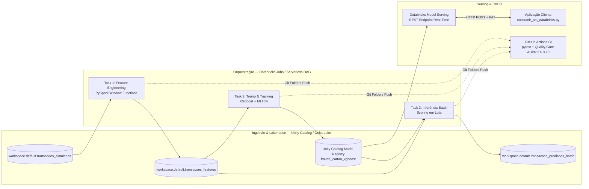

# 💳 Detecção de Fraudes em Cartões de Crédito: Do Cost-Sensitive Learning ao MLOps em Produção no Lakehouse


Este projeto constrói uma solução **end-to-end** de detecção de fraudes em cartões de crédito — partindo da modelagem estatística sob desbalanceamento extremo e otimização financeira (*Cost-Sensitive Learning*) até a engenharia de dados distribuída em **PySpark**, governança no **Unity Catalog**, deploy de API REST em tempo real (**Model Serving**), inferência em lote, orquestração em **DAG** e integração contínua (**CI/CD com Quality Gate automático**).

Em vez de parar em um notebook exploratório, o projeto responde a duas perguntas essenciais da indústria financeira:

1. **Ciência de Dados & Negócio:** como detectar eventos raros (< 0,2%) maximizando o dinheiro salvo sem destruir a experiência do cliente com falsos bloqueios?
2. **Engenharia de ML & MLOps:** como transformar esse modelo em um pipeline reprodutível, livre de *data leakage*, versionado, testado automaticamente e acessível via API HTTP?

## Índice

- [Arquitetura do Sistema](#arquitetura-do-sistema-end-to-end)
- [Problema de Negócio](#o-problema-de-negócio-e-a-matemática-do-desbalanceamento)
- [Stack Tecnológica](#stack-tecnológica-e-justificativa-das-escolhas)
- [Fase 1 — Abordagem Estatística](#fase-1-abordagem-estatística-dataset-do-kaggle)
- [Fase 2 — Visão de Negócios e Cost-Sensitive Learning](#fase-2-visão-de-negócios-feature-engineering-e-cost-sensitive-learning)
- [Fase 3 — Engenharia Distribuída](#fase-3-engenharia-de-features-distribuída-no-lakehouse-pyspark--unity-catalog)
- [Fase 4 — Treino e Model Serving](#fase-4-treino-governança-no-mlflow-e-endpoint-rest-em-tempo-real)
- [Fase 5 — Batch, DAG e CI/CD](#fase-5-inferência-em-lote-orquestração-dag-e-ci-cd)
- [Estrutura do Repositório](#estrutura-do-repositório)
- [Como Executar](#como-executar-localmente-testes--consumo-da-api)

---

## 🏗️ Arquitetura do Sistema (End-to-End)



---

## 🎯 O Problema de Negócio e a Matemática do Desbalanceamento

Detectar fraudes é encontrar uma agulha em um palheiro com **custos assimétricos**:

- **Falso Negativo (fraude aprovada):** prejuízo financeiro direto (*chargeback*), perda do valor integral da transação e custos operacionais de contestação.
- **Falso Positivo (cliente legítimo bloqueado):** atrito na jornada de compra, perda de receita imediata, custo de atendimento e risco de *churn* (troca de cartão na carteira).

Se um modelo trivial aprovar 100% das compras em uma base com 0,17% de fraude, ele alcançará **99,83% de acurácia** enquanto causa prejuízo milionário. Por isso, todo o projeto abandona a acurácia em favor de métricas sensíveis à classe minoritária (**AUPRC**) e de métricas financeiras diretas (**Dinheiro Salvo vs. Falsos Alarmes**).

---

## 🛠️ Stack Tecnológica e Justificativa das Escolhas

| Camada | Tecnologia | Por que foi escolhida? |
| :--- | :--- | :--- |
| **Prototipação & Estatística** | Python, Pandas, NumPy, Scikit-Learn, Matplotlib | Iteração rápida para experimentação estatística, escalonamento robusto e simulação financeira de *thresholds*. |
| **Modelagem Preditiva** | XGBoost (`XGBClassifier`) | *Gradient Boosting* em árvores oferece alta performance em dados tabulares, captura interações não-lineares entre comportamento e valor, e aceita ponderação nativa de classes (`scale_pos_weight`). |
| **Engenharia Distribuída** | PySpark + Delta Lake | Escala o cálculo de janelas temporais (*rolling windows*) além da memória de uma única máquina e garante transações ACID e *schema enforcement* no Lakehouse. |
| **Governança & MLOps** | Databricks Serverless, MLflow, Unity Catalog | Rastreamento automático de parâmetros/métricas, versionamento centralizado de modelos com linhagem de dados e computação elástica sem gestão manual de clusters. |
| **Serving em Produção** | Databricks Model Serving + `requests` | Exposição do modelo como API REST sem código manual de servidor (via assinatura MLflow) e *scale-to-zero* para eficiência de custos (FinOps). |
| **Orquestração & CI/CD** | Databricks Jobs, Git Folders, GitHub Actions, Pytest | Automação do pipeline em DAG, sincronização direta entre notebooks e Git, e barreira automatizada (*Quality Gate*) contra regressões antes da produção. |

---

## 🚀 Fase 1: Abordagem Estatística (Dataset do Kaggle)

Na primeira etapa, o foco foi dominar o desbalanceamento extremo usando apenas matemática e rigor experimental sobre o dataset clássico do Kaggle (transações de cartões europeus de setembro de 2013):

- **Volume:** 284.807 transações.
- **Desbalanceamento:** apenas **492 fraudes (0,172%)**.
- **Anonimização via PCA (`V1` a `V28`):** por sigilo bancário, as variáveis originais foram projetadas via Análise de Componentes Principais (PCA) em eixos ortogonais. `V1` concentra a maior variância explicada e `V28` a menor; por serem ortogonais, as componentes têm correlação linear nula entre si, eliminando multicolinearidade. Apenas `Time` (segundos desde a 1ª transação) e `Amount` (valor da compra) mantiveram sua escala original.

### Decisões Técnicas e o "Porquê"

1. **Por que `RobustScaler` em vez de `StandardScaler`?**
   - O `StandardScaler` centraliza pela **média** e divide pelo **desvio-padrão**, ambos fortemente distorcidos por compras atípicas de alto valor (*outliers*).
   - O `RobustScaler` usa a **mediana** e o **intervalo interquartil (IQR = Q3 − Q1)**, normalizando `Time` e `Amount` sem permitir que transações extremas comprimam a distribuição das compras normais.
   - **Prevenção de *Data Leakage*:** o `.fit()` foi ajustado estritamente no conjunto de treino e apenas `.transform()` foi aplicado ao teste, impedindo que estatísticas futuras contaminassem a avaliação.

2. **Por que `Class Weights` em vez de *Undersampling* ou *SMOTE*?**
   - *Undersampling* descarta grande parte do histórico legítimo (perdendo informação comportamental valiosa).
   - *SMOTE* interpola pontos sintéticos no espaço de features, o que em bases extremamente desbalanceadas e de alta dimensionalidade frequentemente cria fronteiras artificiais e infla falsos positivos.
   - Configurar **`scale_pos_weight`** (no XGBoost) e **`class_weight='balanced'`** (no Random Forest) modifica diretamente a **função de perda**, penalizando erros na classe fraude proporcionalmente à razão entre classes negativas e positivas ($\frac{N_{neg}}{N_{pos}}$) sem distorcer a distribuição real dos dados.

3. **Por que AUPRC em vez de Acurácia ou ROC-AUC?**
   - Em bases com 99,8% de negativos, até a curva ROC-AUC pode parecer artificialmente otimista porque a Taxa de Falsos Positivos ($\frac{FP}{FP + TN}$) é diluída por centenas de milhares de Verdadeiros Negativos ($TN$).
   - A **AUPRC (Área Sob a Curva Precision-Recall)** ignora $TN$ e foca estritamente na capacidade do modelo de capturar fraudes (*Recall*) mantendo alta pureza nos bloqueios (*Precision*).

### Resultados da Fase 1

- **Random Forest:** `AUPRC = 0.8656`
- **XGBoost:** `AUPRC = 0.8608`
- **Desempenho na classe fraude (`classification_report`):** **87% de Precision** (a cada 100 bloqueios, 87 eram fraudes reais) e **86% de Recall** (86% do volume total de fraudes interceptado).

---

## 🧠 Fase 2: Visão de Negócios, Feature Engineering e Cost-Sensitive Learning

Em bancos reais, modelos não consomem colunas anônimas de PCA; eles consomem **comportamento transacional**. Utilizando a metodologia do simulador de transações do *Machine Learning Group* da ULB (*Université Libre de Bruxelles*), foi gerada uma base transacional com timestamps, valores, IDs de clientes e IDs de terminais.

### 1. Engenharia de Variáveis Comportamentais

Árvores de decisão não aprendem que "o Cliente 88 é fraudador" — IDs arbitrários não generalizam para novos clientes. A base bruta foi transformada em sinais comportamentais:

- **Padrões Temporais (`TX_TIME_HOURS`, `TX_DAY_OF_WEEK`):** captura anomalias de horário (ex.: compras de alto valor de madrugada).
- **Regras de Velocidade / *Velocity Rules* (`TX_COUNT_1H`, `TX_SUM_1H`, `TX_COUNT_24H`, `TX_SUM_24H`):** janelas móveis que medem a frequência e o volume financeiro gasto pelo cliente na última 1h e nas últimas 24h — padrão clássico de teste de cartão seguido de múltiplas compras rápidas antes do bloqueio.
- **Risk Scoring de Terminal (`RISCO_TERMINAL`):** taxa histórica acumulada de fraude associada ao terminal (lojista), sinalizando pontos de venda comprometidos ou com terminais clonados.

### 2. Diagnóstico Crítico da Importância de Variáveis (`TX_AMOUNT`)

O XGBoost treinado nessa matriz atingiu **`AUPRC = 0.81`** e **`Precision = 100%`**, com `feature_importances_` atribuindo peso `1.0` à variável `TX_AMOUNT`.

- **O que isso revela tecnicamente:** no cenário base do simulador, um dos padrões de fraude injetados segue uma regra abrupta de esvaziamento de limite por valor, que a árvore isolou perfeitamente. Em ambiente real, uma única feature dominar 100% da importância é um **sinal de alerta analítico** que exige auditoria contra regras determinísticas triviais e vazamento temporal — motivando o desenho rigoroso de janelas sem *leakage* implementado em escala na Fase 3.

### 3. Cost-Sensitive Learning: Otimizando Dinheiro, não apenas Probabilidade

O *threshold* padrão de `0.50` assume que Falsos Positivos e Falsos Negativos custam o mesmo — o que é falso em pagamentos.

- Avaliamos iterativamente limiares de probabilidade de **`0.1` a `0.9`**, cruzando cada corte com o **montante financeiro salvo** (fraudes bloqueadas) e o **volume de Falsos Alarmes** (clientes legítimos bloqueados).
- O gráfico executivo **"Dinheiro Salvo vs. Falsos Alarmes"** transfere a calibração do corte da esfera puramente estatística para a decisão de negócio: a diretoria define qual taxa de atrito suporta para maximizar a recuperação financeira.

**Trade-off de negócios — Dinheiro Salvo vs. Falsos Alarmes**

<!-- Adicione o arquivo trade_off_negocios.png à pasta docs/images/ para exibir o gráfico. -->


---

## ⚡ Fase 3: Engenharia de Features Distribuída no Lakehouse (PySpark + Unity Catalog)

**Notebook:** `notebooks/fase3_feature_engineering_pyspark`

Para sair de um script local em memória e atingir padrão de produção para milhões de transações, toda a engenharia de variáveis foi migrada para **PySpark** no **Databricks Serverless** integrado ao **Unity Catalog**.

### Decisões Técnicas e o "Porquê"

1. **Por que PySpark + Delta Lake em vez de Pandas + CSV?**
   - **Escalabilidade:** o Pandas carrega todo o dataset na RAM de um único nó; o PySpark distribui partições entre executores e otimiza o plano físico via *Catalyst Optimizer*.
   - **Avaliação Preguiçosa (*Lazy Evaluation*):** transformações são empilhadas em um grafo lógico e executadas de forma otimizada apenas quando uma ação (`.show()`, `.write`) é disparada.
   - **Unity Catalog & Delta Lake:** substituir leituras de CSV por caminhos relativos pela tabela gerida `workspace.default.transacoes_simuladas` e gravar a saída em `workspace.default.transacoes_features` elimina problemas de caminho de arquivo, garante transações **ACID**, controle de versão dos dados (*Time Travel*) e *schema enforcement*.

2. **Por que converter `TX_DATETIME` para Unix Timestamp (`TX_UNIX_TIME`) nas *Window Functions*?**
   - No PySpark, `Window.rangeBetween(inicio, fim)` opera sobre valores numéricos ordenados. Converter a data para segundos (`unix_timestamp`) permite janelas **estritamente temporais** — exatamente `3600` segundos (1 hora) e `86400` segundos (24 horas) — em vez de contar um número fixo de linhas (`rowsBetween`), que distorceria clientes que compram 1 vez por mês versus clientes que compram 5 vezes em 10 minutos.

3. **Como o *Data Leakage* (Vazamento de Dados) foi matematicamente bloqueado?**
   - **Exclusão da própria transação nas *Velocity Rules*:** ao calcular `TX_COUNT_1H`, `TX_SUM_1H`, `TX_COUNT_24H` e `TX_SUM_24H`, subtraímos explicitamente a linha atual (`count - 1` e `sum - TX_AMOUNT`), garantindo que a janela represente apenas o histórico *anterior* ao evento avaliado.
   - **Janela histórica estrita em `RISCO_TERMINAL`:** o risco do terminal usa `Window.partitionBy("TERMINAL_ID").orderBy("TX_UNIX_TIME").rowsBetween(Window.unboundedPreceding, -1)`. O limite `-1` impede que o rótulo `FRAUD` da transação atual ou de transações futuras vaze para o cálculo; para a primeira transação de um terminal novo (onde a média histórica é `NULL`), `F.coalesce(..., F.lit(0.0))` atribui risco neutro inicial `0.0`.
   - **Remoção de IDs arbitrários:** `CUSTOMER_ID` e `TERMINAL_ID` são descartados antes da matriz final, deixando apenas as **8 features comportamentais** (`TX_AMOUNT`, `TX_TIME_HOURS`, `TX_DAY_OF_WEEK`, `TX_COUNT_1H`, `TX_SUM_1H`, `TX_COUNT_24H`, `TX_SUM_24H`, `RISCO_TERMINAL`) + o alvo `FRAUD`.

---

## 🧪 Fase 4: Treino, Governança no MLflow e Endpoint REST em Tempo Real

**Notebook:** `notebooks/fase4_treino_mlflow_serving`  
**Cliente API:** `consumir_api_databricks.py`

### 1. Rastreamento e Registro no Unity Catalog

- **Por que MLflow + `databricks-uc`?** Em vez de salvar arquivos `.pkl` soltos em pastas locais, cada experimento registra automaticamente hiperparâmetros (`n_estimators`, `max_depth`, `scale_pos_weight`), a métrica oficial (`auprc`) e o artefato do modelo em `workspace.default.fraude_cartao_xgboost` com versionamento incremental (`Version 1`, `Version 2`, ...).
- **Por que `infer_signature`, `float64` e `input_example`?**
  - A assinatura (*signature*) registra formalmente os nomes e tipos esperados de entrada e saída no Unity Catalog, funcionando como um contrato de API.
  - A padronização explícita das features para `float64` evita rejeições de schema quando payloads JSON enviam inteiros ou decimais (`4` vs. `4.0`).
  - Essa assinatura permite **deploy *no-code*** no Databricks Model Serving sem precisar escrever e manter um servidor Flask/FastAPI manualmente.

### 2. Deploy Real-Time (`fraude-cartao-endpoint`) e FinOps

- O modelo registrado foi implantado em computação **Serverless CPU (Small, 4 GB/worker)** com **`scale-to-zero` (`0-4 concurrency`)**.
- **Por que `scale-to-zero`?** Reduz o custo de infraestrutura ociosa a zero quando não há requisições. O *trade-off* técnico é o ***cold start*** (latência maior na primeira chamada após hibernação), tratado no cliente `consumir_api_databricks.py` com `timeout=180` segundos — após aquecido, as predições subsequentes retornam em milissegundos.

### 3. Segurança e Consumo via HTTP POST

- **Autenticação por Privilégio Mínimo:** o acesso à API utiliza um *Personal Access Token* (PAT) configurado com validade curta (7 dias) e escopo restrito exclusivamente a **Model Serving (`Read + Write`)** — sem acesso a SQL, notebooks ou dados do workspace.
- **Zero credenciais no código:** `consumir_api_databricks.py` exige o token via variável de ambiente (`os.environ["DATABRICKS_TOKEN"]`), evitando qualquer vazamento de segredos no histórico do Git.

#### Exemplo de Payload (`dataframe_split`) e Resposta Validada

```json
{
  "dataframe_split": {
    "columns": [
      "TX_AMOUNT", "TX_TIME_HOURS", "TX_DAY_OF_WEEK",
      "TX_COUNT_1H", "TX_SUM_1H", "TX_COUNT_24H", "TX_SUM_24H",
      "RISCO_TERMINAL"
    ],
    "data": [
      [1450.0, 3.0, 6.0, 4.0, 620.5, 5.0, 810.0, 0.35],
      [42.5, 14.0, 2.0, 0.0, 0.0, 1.0, 55.0, 0.0]
    ]
  }
}
```

**Retorno real do endpoint (`fraude_cartao_xgboost-1`):**

```json
{
  "predictions": [1, 0]
}
```

- **Transação 1 (`1` — BLOQUEAR):** compra de $1.450 às 03h da manhã, 4 compras na última hora e risco histórico de terminal de 0,35.
- **Transação 2 (`0` — APROVAR):** compra de $42,50 às 14h, sem histórico suspeito na última hora e risco de terminal 0,0.

**Teste da API no Databricks Model Serving**

<!-- Adicione o arquivo serving_try_in_browser.png à pasta docs/images/ para exibir a captura. -->


**Consumo da API via terminal Python**

<!-- Adicione o arquivo terminal_api_response.png à pasta docs/images/ para exibir a captura. -->


---

## 🔄 Fase 5: Inferência em Lote, Orquestração (DAG) e CI/CD

### 1. Arquitetura Dual de Serving: Real-Time + Batch (`fase5_inferencia_batch`)

Sistemas antifraude maduros operam em duas cadências complementares:

- **Tempo Real (Fase 4):** decisão síncrona de bloqueio no momento da compra.
- **Lote / Batch (Fase 5):** o notebook `fase5_inferencia_batch` consulta dinamicamente a versão mais recente do modelo no Unity Catalog via `MlflowClient`, pontua toda a tabela de features gerando `PREDICAO_FRAUDE` e `PROBABILIDADE_FRAUDE` e persiste o resultado na tabela Delta `workspace.default.transacoes_predicoes_batch` para auditoria, monitoramento de *drift* e dashboards executivos.

### 2. Orquestração Automatizada (`Jobs & Pipelines`)

Para eliminar execuções manuais e garantir reprodutibilidade, os três notebooks foram encadeados em um Job Serverless chamado **`pipeline_antifraude_end_to_end`**:

1. **`feature_engineering`** (`fase3_feature_engineering_pyspark`)
2. **`treino_mlflow`** (`fase4_treino_mlflow_serving`) — *Depends on:* `feature_engineering`
3. **`inferencia_batch`** (`fase5_inferencia_batch`) — *Depends on:* `treino_mlflow`

**Por que usar um DAG orquestrado?** Garante execução determinística (o treino nunca roda com features desatualizadas), isola falhas por etapa (com logs independentes por tarefa) e permite agendamento periódico (ex.: retreinamento semanal).

**Orquestração DAG no Databricks Jobs**

<!-- Adicione o arquivo databricks_job_dag.png à pasta docs/images/ para exibir a captura. -->


### 3. Versionamento com Git Folders e CI/CD com Quality Gate (GitHub Actions)

O workspace do Databricks foi integrado diretamente a este repositório via **Git Folders**, permitindo `Commit & Push` a partir do próprio ambiente Lakehouse.

A cada `push` ou `pull_request` na branch `main`, o workflow `.github/workflows/ci_pipeline.yml` provisiona um ambiente Python 3.11 limpo e executa a suíte **`pytest`** (`tests/test_pipeline.py`) com quatro barreiras automatizadas:

1. **`test_integridade_schema_e_nulos`:** assegura exatamente as 8 features esperadas, ausência de valores nulos e bloqueio contra vazamento de colunas de ID (`CUSTOMER_ID`, `TERMINAL_ID`).
2. **`test_risco_terminal_sem_vazamento_futuro`:** teste unitário determinístico que verifica se o cálculo histórico de `RISCO_TERMINAL` usa exclusivamente transações estritamente anteriores (`[0.0, 1.0, 0.5]`).
3. **`test_quality_gate_auprc` (Quality Gate):** bloqueia o pipeline se o modelo treinado obtiver **`AUPRC < 0.70`**, impedindo que degradações silenciosas de código cheguem à produção.
4. **`test_contrato_payload_serving`:** valida o formato `dataframe_split` e confirma que o modelo continua classificando corretamente o par de referência `[fraude, legítima] -> [1, 0]`.

---

## 📂 Estrutura do Repositório

```text
fraude-cartao-mlops/
├── .github/
│   └── workflows/
│       └── ci_pipeline.yml                  # Esteira CI no GitHub Actions (Pytest + Quality Gate)
├── notebooks/
│   ├── fase3_feature_engineering_pyspark.py # ETL distribuído com Window Functions sem data leakage
│   ├── fase4_treino_mlflow_serving.py       # Treino XGBoost, tracking MLflow e registro no Unity Catalog
│   └── fase5_inferencia_batch.py            # Scoring em lote usando a versão mais recente do modelo
├── tests/
│   └── test_pipeline.py                     # Testes de schema, leakage temporal, Quality Gate e contrato API
├── consumir_api_databricks.py               # Cliente HTTP POST seguro para o endpoint em produção
├── requirements.txt                         # Dependências para reprodutibilidade e CI
└── README.md
```

---

## ▶️ Como Executar Localmente (Testes & Consumo da API)

### 1. Instalar dependências e rodar a suíte de testes + Quality Gate

```bash
pip install -r requirements.txt
pytest -v -s tests/test_pipeline.py
```

### 2. Consumir o Endpoint Real-Time no Databricks

Defina o seu Personal Access Token (com escopo *Model Serving Read + Write*) na variável de ambiente e execute o cliente.

**Windows (PowerShell):**

```powershell
$env:DATABRICKS_TOKEN="dapiSEU_TOKEN_AQUI"
python consumir_api_databricks.py
```

**Linux / macOS:**

```bash
export DATABRICKS_TOKEN="dapiSEU_TOKEN_AQUI"
python3 consumir_api_databricks.py
```

**Saída esperada:**

```text
Resposta da API Databricks: {'predictions': [1]}
Decisão: BLOQUEAR (FRAUDE)
```
